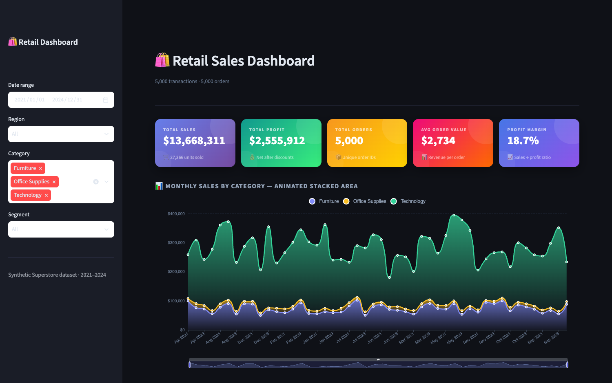
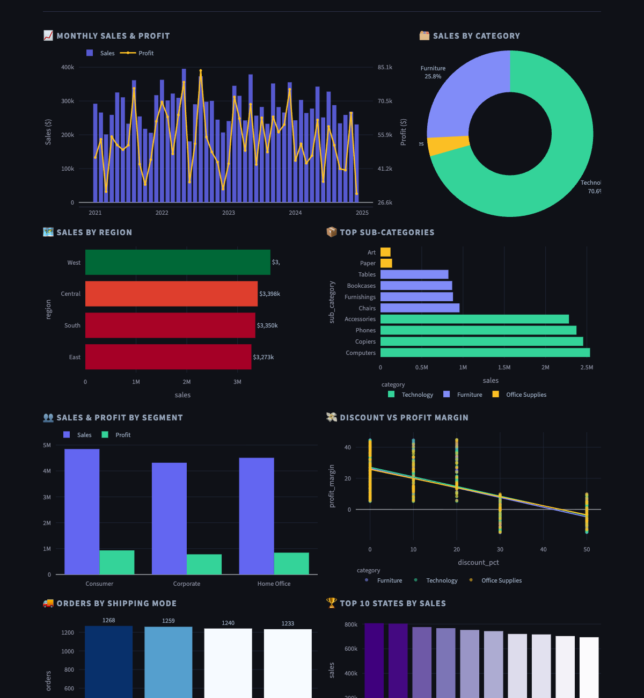

# 🛍️ Retail Sales Dashboard

Interactive retail analytics dashboard built with **Streamlit** + **Plotly** + **Apache ECharts**, deployable on AWS with **Terraform**.






## Project structure

```
retail-dashboard/
├── app.py                  # Entry point — thin orchestrator
├── generate_data.py        # Synthetic dataset generator
├── requirements.txt
├── Makefile                # Dev & Terraform shortcuts
│
├── src/                    # Application source (component-based architecture)
│   ├── config.py           # Colors, AWS settings, theme constants
│   ├── data/
│   │   └── loader.py       # Data loading — local CSV or S3 with caching
│   └── components/
│       ├── sidebar.py      # Sidebar filters widget
│       ├── kpi.py          # KPI cards (HTML/CSS)
│       ├── echarts.py      # Animated stacked-area (Apache ECharts)
│       └── charts.py       # All Plotly chart builders
│
└── terraform/              # Infrastructure as Code
    ├── main.tf             # S3, EC2, IAM, Security Group, Key Pair
    ├── variables.tf
    ├── outputs.tf
    ├── user_data.sh        # EC2 bootstrap script
    └── terraform.tfvars.example
```

## Local development

```bash
# 1. Install dependencies
make setup

# 2. Generate dataset
make data

# 3. Run dashboard
make run
# → http://localhost:8501
```

## Deploy to AWS

### Prerequisites
- [Terraform](https://developer.hashicorp.com/terraform/install) ≥ 1.5
- AWS credentials configured (`aws configure`)

```bash
# 1. Generate dataset first
make data

# 2. Copy and edit vars (optional)
cp terraform/terraform.tfvars.example terraform/terraform.tfvars

# 3. Init, plan, apply
make tf-init
make tf-plan
make tf-apply
# → Outputs: dashboard_url, ssh_command, s3_bucket
```

Terraform will automatically:
- Create an S3 bucket and upload the dataset + app code
- Generate an SSH key pair and save the `.pem` locally
- Create an IAM role so EC2 reads S3 without hardcoded credentials
- Launch an EC2 t3.micro with a systemd service running Streamlit

### Destroy all resources

```bash
make tf-destroy
```

## Architecture

```
Browser → EC2 t3.micro (Streamlit :8501)
               │ IAM role (no hardcoded keys)
               ▼
          S3 Bucket
          └── data/retail_data.csv
```

## Dashboard features

| Section | Chart type |
|---|---|
| KPI cards | HTML/CSS gradient cards |
| Monthly sales by category | Apache ECharts stacked area (animated) |
| Sales & profit over time | Plotly dual-axis bar + line |
| Sales by category | Plotly donut chart |
| Sales by region | Plotly horizontal bar (colored by profit) |
| Top sub-categories | Plotly horizontal bar |
| Sales & profit by segment | Plotly grouped bar |
| Discount vs margin | Plotly scatter with OLS trendline |
| Orders by shipping mode | Plotly bar |
| Top 10 states | Plotly bar |
| Raw data | Streamlit dataframe with CSV download |
